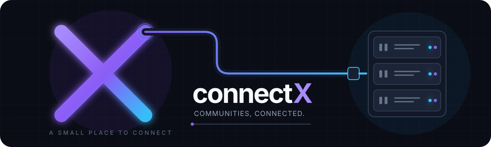

# connectX

a small place to connect

<p align="center">
  
</p>

ConnectX is an original, desktop-first community chat app for Windows and Linux. A browser version can use the same API later.

## What's implemented

- React + Electron desktop client with an original dark UI
- Account registration and sign-in
- Password hashing with bcrypt
- PostgreSQL database through Prisma
- Starter space and channels
- Persistent channel message history
- Live channel message delivery with Socket.IO
- Per-user space membership checks
- Request validation, authentication rate limits, message rate limits, and Helmet security headers
- A server URL field on the sign-in screen, so installed clients can connect to a separately hosted ConnectX server
- Windows NSIS installer and portable executable build targets
- Linux AppImage and Debian package build targets
- GitHub Actions workflow to build desktop packages

## Built in the open

ConnectX is still an early project, and bugs are part of building something new. If something breaks, please report it through the repository's **Issues** tab with steps to reproduce and any relevant error messages. I try to keep up with feedback and respond to reports across my projects as soon as I can.

## Requirements

- Node.js 22.12+ recommended
- Docker Desktop (or another PostgreSQL 17 server)
- npm

## Run locally on Windows

1. Clone the repository and install packages:

   ```powershell
   git clone https://github.com/carjam120443-netizen/connectX.git
   cd connectX
   npm install
   ```

2. Create your local environment file:

   ```powershell
   Copy-Item .env.example .env
   ```

3. Edit `.env`. Set `POSTGRES_PASSWORD` to a password of your choice, make the password in `DATABASE_URL` match it, and replace `JWT_SECRET` with a long random secret. Generate one with:

   ```powershell
   node -e "console.log(require('crypto').randomBytes(48).toString('hex'))"
   ```

4. Start PostgreSQL:

   ```powershell
   docker compose up -d db
   ```

5. Apply the database migration and create the starter space:

   ```powershell
   npm run db:generate
   npm run db:deploy
   npm run db:seed
   ```

6. Start the API, Vite, and Electron together:

   ```powershell
   npm run dev
   ```

The desktop app opens on the sign-in screen. Create an account; it will be added to the starter space.

### Run the API and database in Docker

After configuring `.env`, run:

```powershell
docker compose up --build -d
```

This starts PostgreSQL and the API container. In a second terminal, run only the desktop client:

```powershell
npm run dev:desktop
```

To stop the services:

```powershell
docker compose down
```

Use `docker compose down -v` only if you intentionally want to delete the local PostgreSQL data volume.

## Desktop builds

Builds are written to the `release/` folder.

### Windows

```powershell
npm install
npm run dist:win
```

This creates:
- **NSIS setup installer** — normal install flow, Start Menu shortcut, Desktop shortcut, and install-location choice
- **Portable executable** — runs without a traditional installation

### Linux

Run this on a Linux machine:

```bash
npm install
npm run dist:linux
```

This creates:
- **AppImage** — portable application image
- **.deb package** — installable Debian/Ubuntu package

### GitHub Actions builds

Open the repository's **Actions → Build desktop installers → Run workflow** page to build both Windows and Linux packages. A version tag beginning with `v` also triggers the workflow. The resulting files are uploaded as workflow artifacts.

## Connecting multiple people

The desktop installer is the client, not the hosted service. For different people to chat with one another, the ConnectX API and PostgreSQL database must run on a server reachable by everyone. Deploy the API with HTTPS, then enter that server's base URL (for example, `https://chat.example.com`) on each client's sign-in screen.

For a public deployment:
- Set a strong, unique `JWT_SECRET`.
- Set a strong `POSTGRES_PASSWORD`.
- Set `WEB_ORIGIN` to the exact web origins you intend to allow.
- Put the API behind HTTPS using a reverse proxy or hosting platform.
- Back up the PostgreSQL volume.
- Do not expose PostgreSQL's port to the public internet.

The local default API address is `http://127.0.0.1:4000`. Remote server addresses must use HTTPS.

## Current limitations

This is an early foundation, not a complete social platform yet:
- One seeded starter space is available; space creation and invitations are not implemented.
- Direct messages, friend requests, presence, attachments, voice/video, moderation tools, and admin controls are not implemented.
- The app currently loads the first space the signed-in user belongs to.
- Installer builds are not code-signed. Windows may show a SmartScreen warning until a publisher certificate is configured.
- The backend is not bundled into desktop installers; it must run locally or be hosted separately.

## Project layout

- `electron/` — Electron desktop shell
- `src/` — React interface and API/socket client
- `server/` — Express API and Socket.IO server
- `prisma/` — PostgreSQL schema, migration, and starter seed
- `.github/workflows/` — Windows and Linux desktop build workflow
- `docker-compose.yml` — local PostgreSQL and API services

## Goals

- [x] Start release packages
